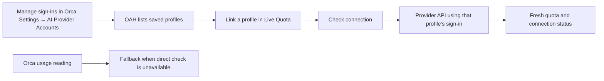

# Provider account management and live quota review

Reviewed against the Orca account list on 2026-11-23 and the current OAH checkout. The local Orca host has nine saved profiles across Claude, Codex, and Antigravity. It has no saved OpenCode or Devin profiles.

## Account flow

OAH stores linked Orca profile IDs in its local configuration. Provider credentials remain with Orca or the provider CLI. Direct checks do not create accounts or change the active provider sign-in. Manual checks target linked profiles and respect provider backoff.

At review time, no profiles were linked in OAH, so the current live host had not made direct quota requests. I left the user's profiles unlinked.

## Provider coverage

| Provider | Saved profiles | Direct quota source | Current limitation |
| --- | ---: | --- | --- |
| Claude | 3 | OAuth profile identity verification, then Anthropic usage API | Expired profile tokens need the user to sign in again in Orca. |
| Codex | 3 | `codex app-server account/rateLimits/read`, with account ID verification | Needs the profile's managed Codex home on this host. |
| Antigravity | 3 | Google identity verification, then Cloud Code quota API | The native `agy` token is for the current sign-in. OAH cannot directly check the other saved profiles without an Orca API that exposes each profile's credential safely. |
| OpenCode Go | 0 | OpenCode Go usage API, using that profile's saved credential | No saved profile is present on this host. Monthly quota is included when returned by the provider. |
| Devin | 0 | Devin status API, using that profile's saved credential | No saved profile is present on this host. |

For Antigravity, Orca's account listing includes cached usage readings for saved profiles. These are useful as fallback readings, but they are not an OAH direct provider check. The `Check connection` status must continue to distinguish those sources.

## Data and status

- **Link** stores the selected profile ID. It does not copy the provider token into OAH.
- **Check connection** calls the direct provider path for linked profiles. It reports stale sign-in and rate-limit failures separately from any fallback reading.
- **Orca readings** can still appear when a direct check fails or is unavailable. The interface labels whether a reading came from Orca or a direct provider check.
- OpenCode Go returns rolling, weekly, and monthly windows. Live Quota now displays the monthly window instead of dropping it.

## Review findings

1. OAH's no-account state in **Accounts** directs the user to **Orca Settings → AI Provider Accounts**. The **Live Quota** view hides providers with no saved profiles.
2. OpenCode and Devin paths exist, but real credential checks cannot be exercised on this host until accounts are saved in Orca.
3. Antigravity is the remaining multi-account gap for direct checks. Avoid switching `agy` accounts behind the user's back. A scoped Orca credential-access API would allow OAH to query each linked profile without changing the active login.

## Verification

Typecheck passed. The CLI suite passed all 24 tests, and the plugin suite passed all 431 tests, including checks that preserve inactive Antigravity Orca readings and OpenCode monthly quota through the cache. The local development daemon is running with its Orca bridge connected. The API Backup proxy remains running on port 4080.
